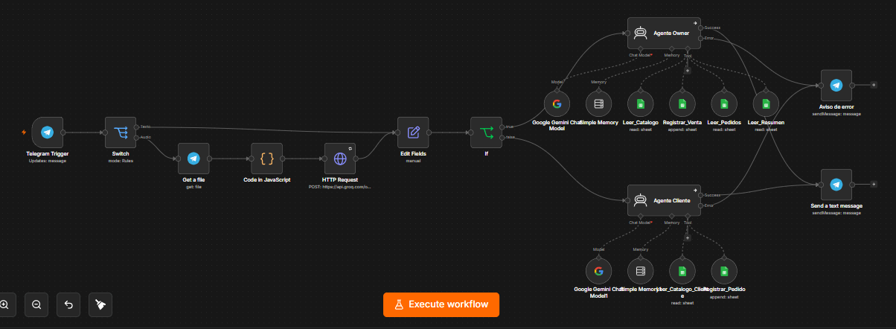

# 🤖 Multi-Agent AI Sales & Inventory Assistant (n8n + Gemini + Groq Whisper)


Sistema conversacional multi-agente orientado a producción para la gestión comercial, registro de ventas por voz/texto y control automático de inventario. Construido sobre **n8n (Self-Hosted)**, **Telegram Bot API**, **Google Gemini**, **Groq Whisper** y **Google Sheets** con arquitectura optimizada bajo principios **FinOps**.



---

## 🎯 Problema de Negocio y Desafío Técnico

Los comercios minoristas suelen perder horas operativas registrando ventas manualmente y respondiendo consultas de precios y disponibilidad. Por otro lado, los prototipos tradicionales de agentes con IA fallan al pasar a producción por tres motivos:
1. **Consumo desmedido de tokens y cuotas (RPD/TPM)** al leer bases de datos completas en cada interacción.
2. **Alucinaciones en operaciones críticas**, como restar mal el stock o duplicar ventas tras un reintento por error de red.
3. **Fugas de seguridad**, permitiendo que un cliente final acceda a costos unitarios o márgenes de ganancia.

---

## 🏗️ Arquitectura y Decisiones de Ingeniería

### 1. Ingesta Multimodal con Cero Consumo en LLM
- Un nodo `Switch` separa mensajes de texto y notas de voz entrantes desde Telegram.
- Los audios `.oga` se descargan, normalizan mediante un nodo `Code` (JavaScript) y se transcriben utilizando **Whisper (`Groq API`)**, convergiendo en una variable unificada (`mensaje_unificado`) antes de invocar cualquier agente.

### 2. Control de Acceso por Identidad (RBAC en Flujo)
- Un enrutamiento condicional (`If`) evalúa el `Chat ID` del remitente y deriva la conversación a dos agentes aislados:
  - **Agente Owner:** Registra ventas calculando automáticamente la ganancia neta, consulta métricas de negocio precalculadas y audita el estado de pedidos.
  - **Agente Cliente:** Atiende consultas comerciales y toma pedidos conectado exclusivamente a una vista sanitizada (`Catalogo_Publico`), **sin acceso a costos ni información de otros clientes**.

### 3. Desacoplamiento de Inventario (Cero Alucinaciones)
- El LLM tiene prohibido modificar el stock directamente (`Update Row` eliminado).
- El agente únicamente inserta registros inmutables (`Append Row`) en la tabla `Ventas`; el stock disponible en `Catalogo` se recalcula en tiempo real en la capa de datos mediante fórmulas (`=G2-SUMIF(...)`).

### 4. Resiliencia y Prevención de Duplicados
- Reintentos controlados (`Retry On Fail`) exclusivamente en llamadas HTTP idempotentes (transcripción de audio y mensajería).
- Reintentos desactivados a nivel de agente para evitar el doble registro de ventas ante errores transitorios (`503`), derivando fallos a una salida de error controlada hacia Telegram.

---

## 📊 Impacto FinOps (Auditoría Antes vs. Después)

Mediante filtrado dinámico de herramientas por categoría (`$fromAI`), vistas `QUERY` precalculadas en Google Sheets y reducción de ventana de contexto, se logró operar holgadamente dentro del tier gratuito de **Google Gemini (`500 RPD` / `250.000 TPM`)**:

| Métrica por Ejecución | Arquitectura Inicial | Arquitectura Optimizada | Reducción |
| :--- | :---: | :---: | :---: |
| **Tokens por consulta de catálogo/BI** | ~22.016 tokens | **1.168 tokens** | **-94.7%** |
| **Tokens por registro completo de venta** | ~25.800 tokens | **1.813 tokens** | **-93.0%** |
| **Llamadas API (RPD) en peor caso** | Hasta 44 RPD | **2 – 5 RPD** | **-88.6%** |
| **Exposición de costos al cliente** | Posible (lectura total) | **0% (`Catalogo_Publico`)** | **Aislado** |

---

## 📂 Estructura del Repositorio

```text
├── assets/
│   └── architecture.png                 # Diagrama completo del workflow en n8n
├── workflow/
│   └── sales_inventory_multiagent.json  # Flujo exportado de n8n (IDs y credenciales sanitizadas)
└── README.md                            # Documentación técnica y métricas FinOps